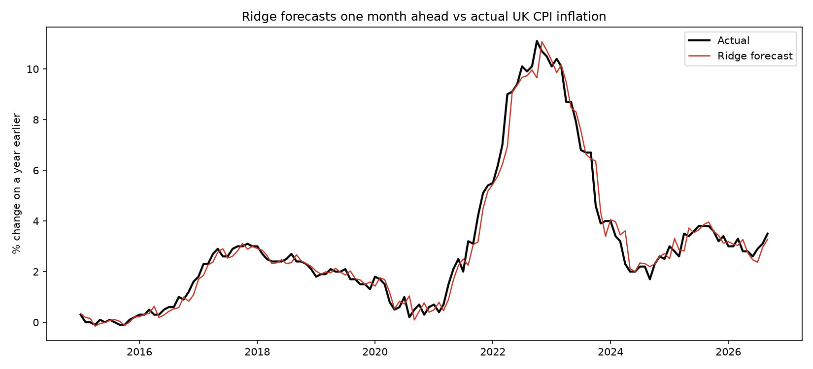

# UK Inflation Forecaster

Can public data beat the simple guess that next month's UK inflation
will equal this month's? Slightly, but not by enough to rule out luck.

Ridge was closer in 80 months and the simple guess in 61 (sign test p = 0.13).

## What I learned

- [Your own point about the 2021-2023 shock]
- [Your own point about why the simple guess is hard to beat]
- [What you would try next]

## How it was tested

Each month is forecast using only earlier months, so the models never see the future.
The data uses current published figures, so it ignores any later revisions.

## Run it yourself

    python3 -m venv .venv
    source .venv/bin/activate
    pip install -r requirements.txt
    python src/download_data.py
    python src/prepare_data.py
    python src/compare.py
    python src/forecast.py

Note that src/download_data.py fetches the latest data, so your numbers may differ.

## Data

- UK CPI annual rate (D7G7): Office for National Statistics
- Brent crude oil price (MCOILBRENTEU) and US dollars per pound (EXUSUK): FRED